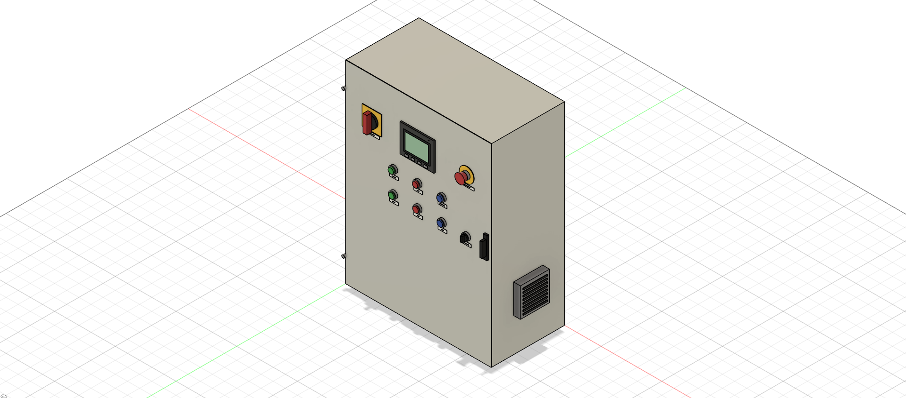
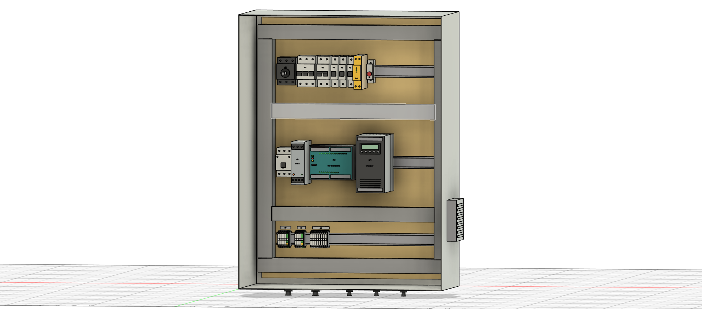

# VFD Conveyor Control Cabinet – EPLAN Electric P8 Schematic + Fusion 3D Layout

Electrical design of a control cabinet for a VFD-driven conveyor: a 400 V 3-phase infeed, variable-frequency drive and motor, a 24 V DC control supply, a two-channel E-stop safety circuit with a safety relay, and a Siemens S7-1200 PLC with an HMI on PROFINET.

Designed in **EPLAN Electric P8 (Education 2027 Update 1)** following IEC 81346 structure and IEC 60617 symbols. The project passes the EPLAN project check with **0 errors**. The same design is laid out as a **3D cabinet model in Autodesk Fusion**, generated by a Python script from the EPLAN device list.

📄 **[View the full schematic (PDF, 17 pages)](docs/CAB1_VFD_CONVEYOR_schematic.pdf)** · 🧊 **[3D cabinet layout](#3d-cabinet-layout-autodesk-fusion)**

| Door (+DOOR) | Mounting plate (+CAB1) |
|---|---|
|  |  |

---

## What's in the cabinet

| Area | Devices |
|---|---|
| Power infeed | Supply terminals `-X0`, incoming cable `-W0` (5G4), main switch `-Q0` (25 A) |
| Drive | MCB `-F1`, line contactor `-K1` (AC-3 9 A), VFD `-U1` (1.5 kW), shielded motor cable `-W1`, motor terminals `-X1`, motor `-M1` (+FIELD) |
| 230 V auxiliaries | MCB `-F2` (1P+N), 24 V DC power supply `-T1` (5 A), cabinet fan `-E1` switched by thermostat `-B1` |
| 24 V distribution | Three protected branches: `-F11` 2 A → 1L+ (PLC/HMI), `-F12` 2 A → 2L+ (inputs/safety), `-F13` 4 A → 3L+ (outputs) |
| Safety | Two-channel E-stop `-S0` (+DOOR) into safety relay `-K10`, reset button `-S4` with `-K1` feedback loop; `-K10` output drives the `-K1` coil |
| Control | PLC `-A1` (CPU 1215C DC/DC/DC), HMI `-A2` (+DOOR), PROFINET to the drive (`-W10`) and HMI (`-W11`) |
| I/O | 8 digital inputs I0.0–I0.7 (start, stop, manual/auto, reset, safety OK, K1 on, overtemperature, PNP part sensor `-B2`), 3 outputs Q0.0–Q0.2 driving indicator lamps `-H1`/`-H2`/`-H3` |

Device tags use a two-level structure: `=CONV` (function) and `+CAB1` / `+DOOR` / `+FIELD` (location), e.g. `=CONV+CAB1-K1`.

## Page overview

| Page | Content |
|---|---|
| 1 | Title page (generated) |
| 2 | Table of contents (generated) |
| 3 | Power infeed and main switch |
| 4 | Drive circuit `-U1` / motor `-M1` |
| 5 | 230 V auxiliaries: PSU, fan |
| 6 | 24 V DC distribution |
| 7 | Safety circuit: E-stop |
| 8 | PLC supply and PROFINET |
| 9 | PLC digital inputs |
| 10 | PLC digital outputs |
| 11–13 | Terminal diagrams `-X0`, `-X1`, `-X2` (generated) |
| 14 | Cable overview (generated) |
| 15–15.2 | Device tag list (generated) |

## Design approach

- **Consistent page layout:** supply rails at the top, protection, switching, main devices, terminals and field devices in fixed height bands, one circuit per column. Rails continue between pages through named interruption points, so cross-references (e.g. `-K1` coil on page 7 ↔ main contacts on page 4) are generated automatically.
- **Distributed device representation:** the safety relay `-K10` is drawn as one main box (A1/A2 supply) plus separate connection points (S11/S12, S21/S22, S33/S34, 13/14, Y32) placed where each circuit needs them, which keeps every circuit in a straight column.
- **Potentials and signals:** a single L+ / M potential is defined at the PSU output. The three fused branches carry the names 1L+, 2L+ and 3L+ across pages, so a short in field wiring cannot take down the PLC supply.
- **PLC addressing:** every PLC connection point has an address, a symbolic name (e.g. `Start_PB`, `Safety_OK`, `Lamp_Fault`) and a function text, ready to be matched with a TIA Portal tag table.
- **Automation features:** wire numbering (signal per page), terminal strip definitions, and generated reports.

## Project check

The final EPLAN check shows **0 errors**. Errors found and fixed during the design:

| Message | Cause | Fix |
|---|---|---|
| Device without main function (`-W0`) | Cable definition not marked as main function | Set main function |
| Several potential definitions on one potential | Potential definitions placed after each 24 V breaker, where EPLAN treats the potential as continuous | One potential definition at the PSU output, branch names 1L+/2L+/3L+ |
| Duplicate connection point designation PE (`-U1`) | PE used on both the supply and motor side of the drive | Renamed to PE1 / PE2 |

The remaining messages are informational (PLC data types not set, PLC overview pages not drawn, cable core counts not entered).

## 3D cabinet layout (Autodesk Fusion)

The schematic's devices are laid out in a 3D model of the cabinet, to check space on the mounting plate, door layout and depth clearances before building.


**Enclosure:** wall-mounted steel enclosure 600 × 800 × 300 mm with a 560 × 760 mm mounting plate, filter fan `-E1` on the right wall and outlet filter on the left, cable glands in the bottom.

**Mounting plate (+CAB1)**, three TS35 DIN rails between 40 × 60 mm slotted cable ducts:

| Rail | Devices (left to right) |
|---|---|
| Top | Main switch `-Q0` with door-coupling shaft, motor breaker `-F1`, MCB `-F2`, 24 V MCBs `-F11` `-F12` `-F13`, safety relay `-K10`, thermostat `-B1` |
| Middle | Contactor `-K1`, 24 V power supply `-T1`, PLC `-A1` (CPU 1215C), VFD `-U1`, with free space on the right for extensions |
| Bottom | Terminal strips `-X0` (infeed), `-X1` (motor), `-X2` (door and field signals), PE terminals green/yellow |

**Door (+DOOR):** main switch handle, HMI `-A2`, E-stop `-S0` with yellow legend ring, indicator lamps `-H1` Running / `-H2` Fault / `-H3` Reset required, push buttons `-S1` Start / `-S2` Stop / `-S4` Reset and selector `-S3` Manual/Auto, each with a legend plate.

**How it's built:** the model is generated by a Fusion Python script ([`fusion-3d/script/CAB1_Cabinet/CAB1_Cabinet.py`](fusion-3d/script/CAB1_Cabinet/CAB1_Cabinet.py)). Every device is a separate component named by its EPLAN device tag (e.g. `-K1 Contactor AC-3 9A`) and carries its tag as raised text, so the 3D model and the schematic use the same designations. Device sizes come from typical catalogue parts (S7-1200 CPU 1215C, PNOZ s3, 1.5 kW drive, 4" HMI, 6.2 mm feed-through terminals). They are stand-ins, to be replaced by manufacturer STEP models once parts are chosen.

To rebuild or modify it: copy `fusion-3d/script/CAB1_Cabinet/` into Fusion's scripts folder (`%APPDATA%\Autodesk\Autodesk Fusion 360\API\Scripts`), open an empty **Hybrid** or **Assembly** design, and run **CAB1_Cabinet** from *Utilities → Add-Ins → Scripts and Add-Ins*. Positions and sizes are set at the top of the script and in the device lists in `build()`.

## Repository contents

```
docs/
  CAB1_VFD_CONVEYOR_schematic.pdf   Full schematic, 17 pages
  images/                           3D cabinet renders
eplan-project/
  CAB1_VFD_CONVEYOR.elk             EPLAN project file
  CAB1_VFD_CONVEYOR.edb/            EPLAN project database
fusion-3d/
  CAB1_VFD_conveyor_cabinet.f3d     Fusion design (3D cabinet layout)
  CAB1_VFD_conveyor_cabinet.step    Same model as STEP, for other CAD tools
  script/CAB1_Cabinet/              Fusion Python script that generates the model
```

To open the schematic, copy `eplan-project/` into your EPLAN projects folder and open `CAB1_VFD_CONVEYOR.elk` in EPLAN Electric P8 2027 or later. To open the 3D model, upload the `.f3d` file in Fusion, or import the `.step` file into any CAD tool.

## Limitations and next steps

- Motor ratings (1.5 kW / 400 V) are placeholders. `-F1`, `-K1`, `-U1` and the motor cable will be resized once the motor data from the Simulink conveyor model is final.
- Part numbers are not yet assigned, so the bill of materials is not included.
- The PDF was printed from the Education edition: it carries an "EPLAN Education" watermark, and its cross-references are not clickable links.
- The 3D model uses stand-in device shapes with typical catalogue dimensions, and wiring is not modelled. Next step: replace them with manufacturer STEP models and add the wiring routes.

## Tools

EPLAN Electric P8 Education 2027 · Autodesk Fusion (Python API) · IEC 81346 / IEC 60617 · Siemens S7-1200 · PROFINET

## Author

Nikhil Sanu Viswam
